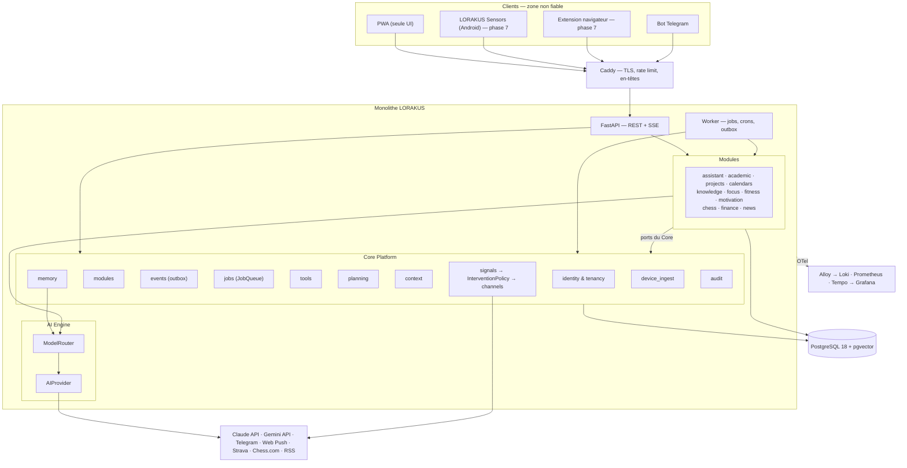

# Architecture de LORAKUS

Version de référence : 1.0 (Mission 2, 2026-11-08). Nom de code : **LORAKUS** (anciennement JARVIS, ADR 0023). Ce document remplace les dossiers de conception des Missions 0 et 1, qui restent consultables pour le raisonnement et les sources.

## 1. Vue d'ensemble

LORAKUS est un **monolithe modulaire** : une seule image Docker lancée sous trois rôles (`api`, `worker`, `migrate`), une seule base PostgreSQL 18, un Core de treize services transverses, un AI Engine derrière un port, et des modules métier qui ne se connaissent pas. Les clients (PWA, bot Telegram, puis LORAKUS Sensors et l'extension navigateur) passent tous par Caddy et l'API.

## 2. Couches (hexagonal pragmatique)

| Couche | Contenu | Dépend de |
| --- | --- | --- |
| `domain` | Entités, value objects, règles pures, événements de domaine | Rien (Python standard + Pydantic) |
| `application` | Cas d'usage, ports (`typing.Protocol`) | `domain` |
| `infrastructure` | Adaptateurs : SQLAlchemy, SDK, HTTP, JobQueue | `application`, `domain` |
| `interfaces` | Routes FastAPI, handlers de jobs, outils IA, handlers d'événements | `application` |

Le DDD complet (agrégats, repositories systématiques) n'est appliqué que là où les règles métier sont riches : `planning`, `academic`, `finance`, `signals`. Les modules de type pipeline (`news`, `chess`) gardent une structure plus simple.

## 3. Core Platform

| Service | Responsabilité | Port exposé aux modules | Phase |
| --- | --- | --- | --- |
| `identity` | Utilisateurs, sessions révocables, TOTP (puis passkeys), rôles `owner`/`admin`, API keys à portée, tenancy et RLS | `CurrentUser`, `PermissionChecker` | 2 |
| `modules` | Découverte (entry points `lorakus.modules`), manifeste, résolution des dépendances, config validée, activation par utilisateur, health checks | `ModuleContext` | 2 |
| `events` | Outbox transactionnelle relayée par le worker, livraison au moins une fois, handlers idempotents | `EventPublisher`, décorateur `@on` | 2 |
| `jobs` | Jobs différés et périodiques, port `JobQueue` (implémentation Procrastinate) | `@job`, `@periodic` | 2 |
| `tools` | Registre des outils IA, validation des arguments, permission, niveau de risque (`read`, `write`, `sensitive`), confirmation utilisateur, audit | `@tool` | 2 |
| `audit` | Journal append-only des actions sensibles | `Audit.record` | 2 |
| `storage` | Fichiers (pièces jointes, médias, imports, exports) derrière le port `BlobStore` : disque local puis stockage compatible S3 (ADR 0024) | `BlobStore` | 3 |
| `agents` | Registre des spécialistes, contrat question/rapport, orchestrateur, filtre de confidentialité, préparations, file d'approbation, traçabilité `core_agent_runs` (ADR 0025 à 0028) | `SpecialistProfile`, `Orchestrator` | 2 → 5 |
| `memory` | Faits typés (`verified`, `proposed`, `inferred`) avec provenance, propositions vérifiées après les conversations, confirmation par l'utilisateur (ADR 0039) ; épisodes et recherche hybride (plein texte + vecteurs locaux) en PR 37 | `MemoryService` (`verified_for_prompt`, `propose_from_messages`), dépendance `get_memory` | 3 |
| `background` | Travaux courts différés dans le processus de l'API, regroupés par clé (ex. analyse d'une conversation quelques minutes après le dernier message) | `DebouncedTasks`, dépendance `get_background` | 3 |
| `planning` | Tâches génériques, créneaux d'agenda, planificateur de journée et de semaine | `Tasks`, `Agenda`, `Planner` | 4 |
| `signals` | Réception des signaux des modules, `InterventionPolicy` (niveaux 0–3, budget, quiet hours, cooldown, dédup, groupement, backoff), canaux (Web Push, Telegram, puis notifications locales Android) | `Signals.emit` | 5 |
| `context` | `PersonalContext` : créneau courant et suivant, deadlines proches, quiet hours, budget restant ; puis état numérique et sportif fournis par les modules | `ContextProvider` (implémenté par les modules) | 5 → 7 |
| `device_ingest` | Réception des lots des appareils (Sensors, extension), clés par appareil, idempotence | Routage vers `device.*` | 7 |

Les ports de `context`, `signals` et `device_ingest` existent dès la phase 2 sous forme de `Protocol`, couverts par des tests de contrat.

## 4. AI Engine

- **Port `AIProvider`** (`backend/lorakus/ai/port.py`) : `chat` (streaming) et `capabilities` depuis la PR 32 ; appels d'outils, `structured` (sortie validée par un modèle Pydantic) et `embed` arrivent avec leurs premiers utilisateurs (PR 36 à 38).
- **Adaptateurs** : Anthropic, Gemini (deux configurations : free tier et payant), OpenAI-compatible (Ollama, NVIDIA NIM, vLLM), `FakeProvider` pour les tests.
- **Embeddings des données personnelles** : locaux (`fastembed`, modèle multilingue compact) — aucune donnée personnelle ne sort pour être vectorisée.
- **`ModelRouter`** (`backend/lorakus/ai/router.py`) : choisit une chaîne `[primaire, repli…]` selon la tâche, la classe de données et les contraintes de licence (`config/routing.toml`), applique le plafond mensuel, le disjoncteur et la coupure générale ; refuse structurellement tout appel externe sur `sensitive` et tout appel sur `no_ai`. Après le premier morceau de réponse, il ne change plus de modèle. Cache de réponses : avec les tâches `structured` (ADR 0007, amendement du 2026-11-12).
- **Coûts** : `config/pricing.toml` daté, journal `core_ai_usage` par utilisateur (ajout seul, RLS), métriques `lorakus_ai_*` par fournisseur et modèle, avertissement à 80 % du plafond, plus aucun appel à 100 % (réponse par gabarit).
- **Sécurité** : profil `ingest` (lit du contenu externe, aucun outil, sortie structurée) et profil `assistant` (outils, jamais de contenu externe brut).

## 5. Modules

| Module | Rôle | Phase |
| --- | --- | --- |
| `assistant` | Conversations, composition des outils des modules actifs, briefing | 3 |
| `calendars` | Abonnements ICS en lecture vers l'`Agenda` | 4 |
| `academic` | Cours, examens, devoirs (crée des tâches), coefficients, retards | 4 |
| `projects` | Idées, projets, tâches de projet, projets inactifs, capture Telegram | 4 |
| `focus` (ex-`digital_activity`) | Spécialiste Sergent : échéances et découpage de tâches (v0), puis sessions d'apps et de pages web, lignes de base, signaux d'attention | 4 (v0), 8 (collecte), 12 (interventions) |
| `sentinel` | Spécialiste Veilleur : inventaire des hôtes déclarés, vulnérabilités, exposition | 7 |
| `knowledge` | Inbox universelle, ingestion, résumés, collections, recherche | 8 |
| `fitness` | Activités multi-sources fusionnées, saisie musculation, objectifs, progression | 9 |
| `motivation` | Curation de contenus Knowledge, sélection contextuelle, « mes raisons » | 10 |
| `chess` | PubAPI Chess.com + sessions web `chess:*` | 12 |
| `finance` | Imports bancaires, catégorisation locale, budgets — 100 % local | 13 |
| `news` | Collecte RSS, déduplication, pertinence, briefing | 14 |

Les règles de couplage et le contrat de manifeste sont dans [`MODULE_SYSTEM.md`](MODULE_SYSTEM.md).

## 6. Clients

| Client | Rôle | Authentification |
| --- | --- | --- |
| PWA | Unique interface utilisateur, sur PC et dans le navigateur Android : chat, Today, pages des modules, réglages, partage Android (Web Share Target) | Cookie de session HttpOnly + CSRF |
| Bot Telegram | Notifications produit, capture rapide d'idées et de liens (les alertes d'exploitation passent par Discord, ADR 0035) | Webhook avec secret, compte Telegram lié à l'utilisateur |
| Lorakus Sensors (app Android séparée, Kotlin) | Collecte UsageStats et Health Connect, sessionisation locale, tampon chiffré, lots HTTPS toutes les 15 min (pas de WebSocket), tuiles « pause » et « concentration », notifications locales pendant une session de concentration ; aucune interface métier (ADR 0013) | Clé d'appareil (Android Keystore), portées `usage:write`, `health:write` |
| Extension navigateur (MV3) | Sessions sur domaines suivis, catégorie de page sans URL complète | Clé d'appareil, portée `usage:write` |

## 7. Flux principaux

1. **Chat** : PWA → SSE → `assistant` → faits confirmés (`MemoryService.verified_for_prompt`) → `ModelRouter.chat` avec les outils autorisés → boucle d'outils via `tools` (permission, confirmation, audit) → réponse streamée → analyse différée des messages de l'utilisateur (faits proposés, ADR 0039).
2. **Signal → intervention** : un module émet `Signals.emit(Signal)` → `InterventionPolicy` consulte `context` → applique niveau, budget, cooldown → au plus une notification, éventuellement avec une pièce jointe fournie par un port (`InspirationProvider`) → feedback de l'utilisateur enregistré.
3. **Calendrier** : job `calendars.sync` (30 min) → lecture ICS → créneaux dans l'`Agenda` → le planificateur et le briefing les voient.
4. **Appareil** (phase 7) : Sensors sessionise localement → lot signé toutes les 15 min → `device_ingest` → événement `device.usage_batch` / `device.health_batch` → modules propriétaires.
5. **Contenu externe** (phase 8) : partage → `knowledge.ingest` (profil `ingest`) → item → collections.

## 8. Données

- **Tenancy** : toute table métier porte `user_id` ; Row Level Security active ; la session SQL pose `app.current_user` ; le rôle applicatif n'est pas superutilisateur.
- **Classes** : `public`, `personal`, `sensitive`. **Contraintes de licence** : `no_ai`, `owner_display_only` (ex. données Strava).
- **Propriété** : chaque module possède ses tables (préfixe `acad_`, `proj_`, `cal_`, `da_`, `know_`, `fit_`, `motiv_`, `chess_`, `fin_`, `news_`) et sa branche Alembic ; le Core utilise `core_`, `mem_`, `plan_`, `sig_`.
- **Migrations** : Alembic, une branche par module, stratégie expand/contract, rejouées en CI (voir [`DEVELOPMENT.md`](DEVELOPMENT.md)).

## 9. Frontières de confiance

| Frontière | Contrôles |
| --- | --- |
| Internet → Caddy | TLS, ports 80/443 seuls, rate limit, fail2ban, en-têtes de sécurité |
| Caddy → API | Session ou clé à portée, validation Pydantic stricte, limites de taille |
| Appareils → `device_ingest` | Clé par appareil révocable, schéma strict, horodatages bornés, idempotence, rate limit |
| API/worker → PostgreSQL | Rôle non superutilisateur, RLS |
| App → fournisseurs IA | `ModelRouter` : classes de données, licences, budget, liste blanche de domaines sortants |
| Contenu externe → LLM | Profil `ingest` sans outils, encapsulation « donnée non fiable », sortie validée |

Détails dans [`SECURITY.md`](SECURITY.md).

## 10. Observabilité

`structlog` (JSON, masquage des secrets et des données sensibles), OpenTelemetry (traces et métriques, attributs `gen_ai.*` pour les appels IA), Alloy comme collecteur, Loki (7 jours), Prometheus (15 jours), Tempo (3 jours, 20 % d'échantillonnage hors erreurs), Grafana (tableaux Plateforme, IA, Notifications, Appareils), sentinelle externe pour la disponibilité (ADR 0036), alertes d'exploitation vers Discord (ADR 0035). Page `/admin` côté produit.

## 11. Déploiement

Production sur une instance Oracle Ampere A1 (ADR 0036), staging éphémère dans la CI et sentinelle externe healthchecks.io (ADR 0037), Docker Compose, images multi-architectures publiées sur GHCR, déploiement en production après approbation, sauvegardes chiffrées hors Oracle. Voir [`DEPLOYMENT.md`](DEPLOYMENT.md).

## 12. Glossaire

| Terme | Définition |
| --- | --- |
| Signal | Fait émis par un module qui *pourrait* justifier une interruption (`academic.deadline_approaching`, `digital.long_session`) |
| Intervention | Décision de l'`InterventionPolicy` d'informer l'utilisateur, avec un niveau (0 à 3) |
| Contexte | Instantané de la situation de l'utilisateur, calculé par `context` |
| Session | Période continue d'utilisation d'une app ou d'une catégorie de page |
| Activité canonique | Activité sportive fusionnée à partir de plusieurs sources |
| Contrainte de licence | Règle d'usage attachée à une donnée par sa source (ex. `no_ai`) |

## 13. Architecture multi-agents (Mission 3)

Statut : **validée** le 2026-11-08 (ADR 0025 à 0027, décisions D-H et D-I). Le reste de ce document reste valable ; cette section décrit comment les spécialistes s'y insèrent.

- **Majordome** : le module `assistant`, unique interlocuteur. Routage d'intention en trois paliers (règles, similarité d'embeddings locaux, LLM léger si ambigu), synthèse, adaptation du ton. Nom affiché configurable.
- **Spécialistes** : des modules qui déclarent un `SpecialistProfile` (voir `MODULE_SYSTEM.md` §10).

| Spécialiste | Module | LLM |
| --- | --- | --- |
| Sergent (Focus & Work) | `focus` | Découpage de tâches seulement |
| Trésorier (Finance) | `finance` | Aucun |
| Préparateur (Health & Fitness) | `fitness` | Aucun |
| Archiviste (Knowledge) | `knowledge` | Résumés et questions de révision citées |
| Analyste (Chess) | `chess` | Aucun (Stockfish) |
| Veilleur (Cybersécurité) | `sentinel` | Aucun |

- **Orchestration** (service `agents`) : questions en parallèle (au plus 4, délai 3 s), rapports typés de 300 tokens maximum, cache invalidé par événements, disjoncteur, traçabilité `core_agent_runs`.
- **Confidentialité** : les faits `sensitive` partent vers le LLM sous forme de marqueurs, réinsérés localement ; `no_ai` n'est jamais transmis (ADR 0027).
- **Proactivité** : signaux → moteur de situations (`signals`, ADR 0030) → `InterventionPolicy`, seul décideur ; friction en trois niveaux, le troisième uniquement par pactes volontaires (ADR 0029).
- **Préparations et approbations** : travaux de fond budgétés, affichés dans Today ; toute action à conséquence externe attend votre accord (ADR 0028).
- **Communication entre spécialistes** : événements et ports lus via le Core ; aucun appel direct.

Chemin d'une question : routage (souvent sans LLM) → orchestrateur → rapports → filtre de confidentialité → synthèse par LLM léger → réinsertion locale → réponse en streaming, le tout dans une seule trace OpenTelemetry.
