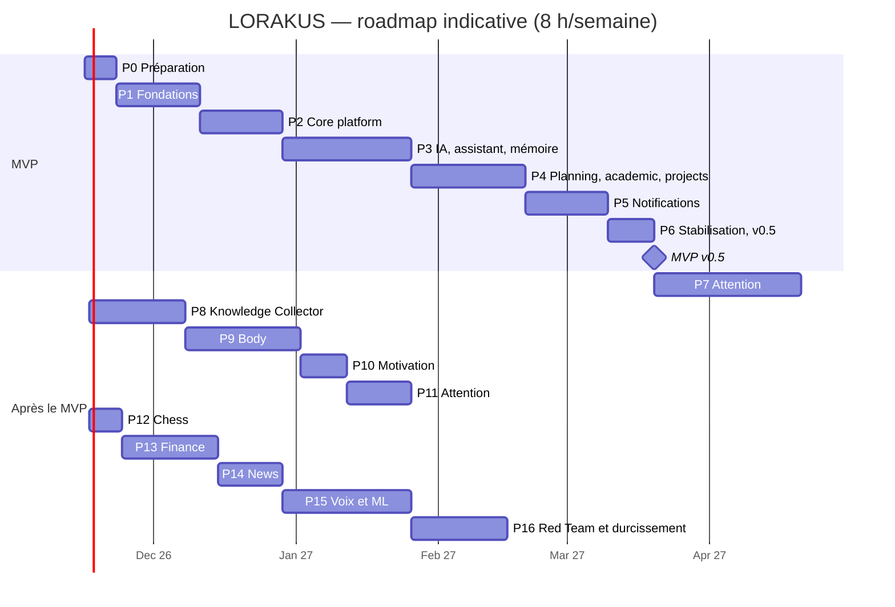

# Roadmap

Version 1.0 (Mission 2, 2026-11-08). Durées indicatives à environ 8 h/semaine, à recaler après la phase 2 sur la vitesse réelle. Une phase n'est close que si la suite E2E des phases précédentes reste verte et si `PROJECT_STATE.md` est à jour.

## MVP — LORAKUS v0.5 (phases 0 à 6, ~17 semaines)

Scénarios d'acceptation :

1. « Qu'est-ce que je dois faire aujourd'hui ? » → réponse juste (tâches, cours ICS, deadlines) en moins de 8 s.
2. « Ajoute le devoir de Machine Learning pour vendredi, environ 3 h » → confirmation → tâche visible dans `/academic` et Today.
3. Briefing à 7 h 30 ; aucune notification pendant les quiet hours.
4. Un seul rappel J-3 pour un devoir non commencé.
5. Idée envoyée au bot Telegram → boîte d'idées de `projects`.
6. Préférence exprimée en conversation → fait proposé → confirmé → utilisé par `plan_week`.
7. API coupée → alerte Telegram en < 5 min ; fournisseur IA coupé → mode dégradé explicite, rappels intacts.
8. Restauration automatique du dernier backup réussie.

---

### P0 — Préparation (1 semaine)

- **Objectif** : environnement prêt, décisions bloquantes prises.
- **Composants** : aucun code.
- **Dépendances** : décisions D-A (hébergement) et D-B (visibilité du dépôt).
- **Tâches** : installer les outils (`DEVELOPMENT.md` §1) ; nom de domaine + DNS Cloudflare ; dépôt GitHub, protection de `main`, environnements `staging`/`production` ; préparer la 2e instance A1 comme staging (utilisateur `deploy`, Docker, firewalld) ; comptes Anthropic, Telegram (BotFather), B2/R2 ; copier cette documentation dans le dépôt.
- **Tests** : —
- **Terminée quand** : `docker run hello-world` passe sur le Dell et les deux instances ; le domaine résout ; le premier commit contient la documentation.
- **Risques** : délais administratifs (domaine, compte Oracle).

### P1 — Fondations techniques (2,5 semaines)

- **Objectif** : un dépôt qui déploie du vide proprement, observé et sauvegardé.
- **Composants** : workspace `uv`, FastAPI `/health`, configuration (`pydantic-settings`), PostgreSQL 18 + pgvector, Alembic (branche `core`), port `JobQueue` + Procrastinate, `structlog` + OpenTelemetry, Compose dev/staging/prod, Caddy, stack Grafana (Alloy, Loki, Prometheus, Tempo, Grafana), sauvegardes chiffrées, CI/CD.
- **Dépendances** : P0.
- **Tâches** : squelette backend et frontend vide ; Dockerfile multi-stage non-root ; `make` ; pre-commit (Ruff, Gitleaks) ; workflows `ci`, `build`, `deploy-staging`, `deploy-prod` ; conteneur `backup` + script de restauration ; tableau Grafana « Plateforme » ; alerte Uptime Kuma.
- **Tests** : unitaires de base, migrations up/down/check en CI, test de restauration, smoke test post-déploiement, scan Trivy.
- **Terminée quand** : `git push` → staging en < 15 min ; une requête visible dans Grafana (log, métrique, trace corrélés) ; restauration réussie ; tag `v0.1.0` déployé en prod.
- **Risques** : s'enliser dans l'outillage → aucune dépendance hors liste.

### P2 — Core platform (2,5 semaines)

- **Objectif** : identité, tenancy, modules, événements et sécurité des outils.
- **Composants** : `identity` (users, sessions, TOTP, rôles, API keys), RLS, `modules` (registre, manifeste, config, activation), `events` (outbox), `tools` (registre, permission, risque, confirmation), `audit`, ports vides `context`/`signals`/`device_ingest`, module `_template`, page `/admin` minimale.
- **Dépendances** : P1.
- **Tâches** : modèles et migrations `core_*` ; middleware de session SQL `app.current_user` ; découverte par entry points ; outbox + relais dans le worker ; décorateur `@tool` ; contrats `import-linter` ; Semgrep règles maison.
- **Tests** : isolation RLS à deux utilisateurs, contrat de manifeste, permissions d'outils (refus, confirmation), idempotence des handlers, import-linter.
- **Terminée quand** : un module de test s'active, expose une route et un outil, émet un événement consommé par un handler ; un second utilisateur ne voit rien.
- **Risques** : registre trop ambitieux → entry points simples, pas de chargement à chaud.

### P3 — AI Engine, assistant, mémoire (4 semaines)

- **Objectif** : converser avec un assistant qui se souvient.
- **Composants** : `AIProvider` + adaptateurs Anthropic, Gemini, Fake ; `ModelRouter` (routing.yaml, budget, retries, circuit breaker, cache) ; module `assistant` (conversations SSE, boucle d'outils) ; `memory` (faits, épisodes, embeddings locaux `fastembed`, recherche hybride) ; frontend : design system, login + TOTP, chat, historique, `/memory`, PWA installable.
- **Dépendances** : P2 ; décisions D-C (framework) et D-D (budget).
- **Tâches** : streaming SSE de bout en bout ; cartes de confirmation ; extraction de faits proposés (job) ; résumé d'épisodes ; tableau Grafana « IA » (tokens, coût, latence, erreurs).
- **Tests** : evals Promptfoo sur Fake (format, refus d'instruction injectée), tests du router (fallback, budget, refus `sensitive`), E2E login → chat → fait confirmé réutilisé.
- **Terminée quand** : utilisé 5 jours consécutifs ; scénario 6 partiel (mémoire) ; coût réel mesuré.
- **Risques** : qualité perçue → itérer sur prompts et contexte avant d'ajouter des fonctions.

### P4 — Planning, academic, projects (3,5 semaines)

- **Objectif** : savoir quoi faire aujourd'hui et cette semaine.
- **Composants** : Core `planning` (tâches, agenda, planificateur), modules `calendars` (ICS), `academic`, `projects`, page Today, outils IA (`create_task`, `list_tasks`, `plan_day`, `plan_week`, `add_assessment`, `create_project`, `capture_idea`, `get_schedule`).
- **Dépendances** : P3 ; décision D-F (planning dans le Core).
- **Tâches** : modèle de tâche générique ; import ICS (récurrences, fuseaux) ; règles de retard et d'urgence ; planificateur glouton sous contraintes (créneaux libres, `max_daily_minutes`) ; projets inactifs ; briefing (liste déterministe + texte généré).
- **Tests** : règles (retard, urgence, planificateur), synchro ICS sur fichiers réels anonymisés, E2E scénarios 1, 2, 6.
- **Terminée quand** : scénarios 1, 2 et 6 réussis sur vos vraies données.
- **Risques** : récurrences ICS et fuseaux → bibliothèque éprouvée et jeux de tests réels.

### P5 — Notifications et InterventionPolicy (2,5 semaines)

- **Objectif** : être prévenu au bon moment, sans spam.
- **Composants** : `signals` (`Signals.emit`), `InterventionPolicy` (niveaux 0–3, budget, quiet hours, cooldown, dédup, groupement, backoff), `context` minimal, canaux Web Push et Telegram (webhook signé, liaison du compte, capture d'idées), préférences, historique, alertes d'exploitation vers Telegram.
- **Dépendances** : P4.
- **Tâches** : signaux `academic.deadline_approaching`, `academic.overdue`, `projects.inactive`, briefing planifié ; actions sur notification (fait, reporter, ignorer) ; tableau Grafana « Notifications ».
- **Tests** : politique sur scénarios simulés (budget, quiet hours, dédup, backoff), webhook Telegram signé, E2E notification push.
- **Terminée quand** : scénarios 3, 4, 5 et 7 réussis ; zéro doublon sur 2 semaines d'usage.
- **Risques** : Web Push capricieux sur Android → Telegram en secours.

### P6 — Stabilisation et release v0.5 (1,5 semaine)

- **Objectif** : un MVP fiable au quotidien.
- **Composants** : aucun nouveau.
- **Dépendances** : P5.
- **Tâches** : corrections issues de l'usage réel ; ZAP baseline sans `medium` ; exercice d'incident ; runbooks ; documentation ; release `v0.5.0`.
- **Tests** : suite E2E complète, scénario 8.
- **Terminée quand** : les huit scénarios passent ; gel des fonctionnalités respecté.
- **Risques** : tentation d'ajouter des fonctions → gel strict.

---

## Après le MVP

### P7 — Attention : collecte (4,5 semaines)

- **Objectif** : mesurer l'usage numérique sans intervenir.
- **Composants** : `device_ingest`, LORAKUS Sensors (UsageStats, sessionisation, Room chiffrée, WorkManager, tuiles pause et concentration), extension navigateur MV3 (domaines suivis, catégories de page), module `digital_activity` (stockage, lignes de base, `/attention`), `context` complet, sessions de concentration, passkeys, page `/settings/devices` et `/settings/data`.
- **Dépendances** : P2, P5 ; décision D-E.
- **Tests** : sessionisation sur traces enregistrées, idempotence et validation des lots, mode dégradé sans permission, mesure batterie.
- **Terminée quand** : sessions à ± 1 min sur 20 cas ; synchro sans trou sur 7 jours ; batterie < 2 %/jour.
- **Risques** : optimisation batterie Samsung ; rétention des événements UsageStats.

### P8 — Knowledge Collector (3 semaines)

- **Objectif** : ne plus perdre ce que vous sauvegardez.
- **Composants** : module `knowledge` (inbox, ingestion URL/texte/fichier, profil `ingest`, résumés, embeddings, collections, recherche), Web Share Target, adaptateur Gemini free tier pour contenus publics, liaison aux projets.
- **Dépendances** : P3.
- **Tests** : corpus d'injections, anti-SSRF, classification.
- **Terminée quand** : un lien partagé depuis Android est résumé et classé en < 60 s ; une injection de test n'a aucun effet.
- **Risques** : contenus TikTok/Instagram inaccessibles → dégradation acceptée (métadonnées).

### P9 — Body (3,5 semaines)

- **Objectif** : suivre le sport sans saisie pénible.
- **Composants** : module `fitness` (Health Connect via Sensors, Strava OAuth + webhook + purge, fusion multi-sources, saisie rapide musculation, objectifs, progression, `/body`), contraintes de licence actives.
- **Dépendances** : P4, P7.
- **Tests** : fusion de doublons, garde `no_ai`, purge à la révocation Strava.
- **Terminée quand** : une course de la montre comptée une fois ; muscu saisie en < 30 s ; aucun champ Strava dans un appel LLM (test automatisé).
- **Risques** : types écrits par Mi Fitness dans Health Connect.

### P10 — Motivation (1,5 semaine)

- **Objectif** : une bibliothèque qui sert au bon moment, pas un fil.
- **Composants** : module `motivation` (cartes sur items Knowledge, « mes raisons », sélection déterministe, `InspirationProvider`, `MotivationMoment`).
- **Dépendances** : P8.
- **Tests** : rotation, repos des contenus ignorés, budget de présentation.
- **Terminée quand** : ≤ 3 présentations/semaine ; aucune redirection vers TikTok/Instagram.
- **Risques** : glissement vers un fil → ADR 0017.

### P11 — Attention : interventions (2 semaines)

- **Objectif** : intervenir à bon escient.
- **Composants** : signaux `digital.*` et `fitness.*`, règles de l'InterventionPolicy pour les situations A–D, étiquetage « c'était voulu », notifications locales Sensors pendant une session de concentration.
- **Dépendances** : P7 + ≥ 8 semaines de données, P9, P10.
- **Tests** : scénarios A–D simulés et réels, budget, backoff.
- **Terminée quand** : situations A–D observées en conditions réelles ; taux de suivi mesuré par règle.
- **Risques** : agacement → seuils prudents, budget de 3/jour.

### P12 — Chess (1 semaine)

PubAPI Chess.com (séquentielle, User-Agent, ETag), consommation des sessions `chess:*`, règle « session longue avec deadline < 48 h ». Terminée quand une session réelle est détectée à ± 2 min et réconciliée avec les parties.

### P13 — Finance (3 semaines)

Imports CSV/OFX, parsing déterministe, déduplication, catégorisation par règles puis classifieur local, budgets, récurrents, anomalies (MAD), prévision, export, suppression, ré-authentification. Terminée quand un import réel passe sans erreur et qu'un test prouve l'absence d'appel réseau pendant l'import.

### P14 — News (2 semaines)

Collecte RSS planifiée, déduplication, pertinence (intérêts, projets), résumés sur free tier (contenu public), briefing. Terminée quand « Quoi de neuf ? » est utile 4 jours sur 5.

### P15 — Voix et ML (ouvert)

Voix (STT/TTS), estimation ML des durées de tâches, classifieur de sessions, bandit d'interventions et de motivation, versionnement et dérive. Chaque modèle doit battre les règles en validation temporelle.

### P16 — Red Team et durcissement (3 semaines)

Agent Red Team isolé (planification, ZAP, Nuclei si utile, Promptfoo, rapports en issues), campagnes mensuelles, revue ASVS niveau 2, fuzzing de `device_ingest`, revue de l'APK, réévaluation de l'hébergement. Terminée quand le rapport mensuel est automatique et qu'aucune vulnérabilité `high` n'est ouverte depuis plus de 30 jours.
