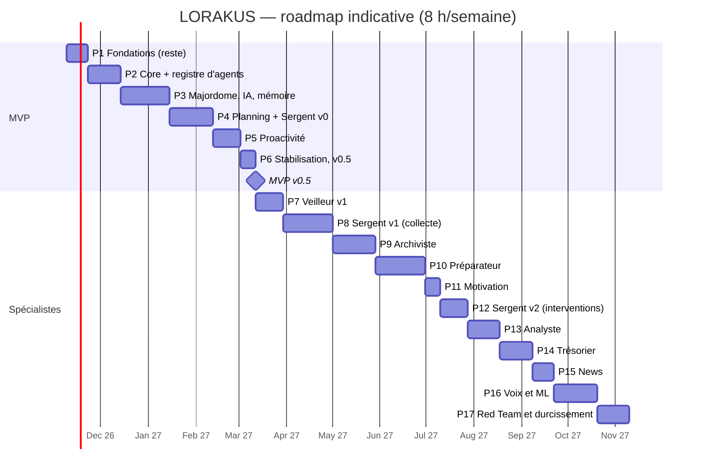

# Roadmap

Version 2.2 (2026-11-09 : environnements de l'ADR 0036, questions de clarification en P4). Version 2.1 (Mission 3 et revue « regard neuf », 2026-11-08) : intègre l'architecture multi-agents validée (ADR 0025 à 0033) avec un MVP allégé. **Gel de la conception jusqu'à la v0.5** : toute nouvelle idée va dans la section « Idées » en fin de fichier et n'est étudiée qu'après le MVP. Durées indicatives à environ 8 h/semaine, à recaler sur la vitesse réelle. Une phase n'est close que si la suite de tests des phases précédentes reste verte et si `PROJECT_STATE.md` est à jour.

## Déjà fait (P0 et début de P1)

Dépôt public protégé, documentation et ADR, backend FastAPI (`/api/health`, `/api/health/ready`), couche base (SQLAlchemy 2 async, psycopg 3, timeouts), Alembic (branche `core`), PostgreSQL 18 + pgvector local avec rôles à moindre privilège, qualité locale (Ruff, pyright strict, pytest, Gitleaks, pre-commit).

## MVP — v0.5 (environ 17,5 semaines)

Scénarios d'acceptation :

1. « Qu'est-ce que je dois faire aujourd'hui ? » → réponse juste (tâches, cours ICS, deadlines), passée par le Sergent, sources citées, en moins de 5 s.
2. « Ajoute le devoir de Machine Learning pour vendredi, environ 3 h » → confirmation → tâche visible dans `/academic` et Today.
3. Briefing du lendemain préparé la nuit et présenté à 7 h 30 ; aucune notification pendant les quiet hours.
4. Un seul rappel J-3 pour un devoir non commencé ; escalade au niveau 2 seulement si le niveau 1 est ignoré.
5. Idée envoyée au bot Telegram → boîte d'idées de `projects`.
6. Préférence exprimée en conversation → fait proposé → confirmé → utilisé par la planification.
7. « Pourquoi m'as-tu dit ça ? » → trace complète (spécialistes appelés, données utilisées, classes transmises au LLM).
8. API coupée → alerte Discord en moins de 5 min ; fournisseur IA coupé → réponse par gabarit, rappels intacts.
9. Restauration automatique du dernier backup réussie.

### P1 — Fondations (terminée le 2026-11-11, v0.1.0)

- **Fait** (PR n°7 à n°18 et PR Runbooks, en production depuis le 2026-11-10) : CI obligatoire, CodeQL, Dependabot, Gitleaks, Trivy, image API non-root, pile Compose durcie, images multi-architectures publiées sur GHCR (PR n°16), déploiement approuvé avec retour automatique (PR n°17), journaux JSON et métriques Prometheus, Grafana, alertes testées vers Discord, sauvegardes chiffrées vers B2 et test de restauration, préparation de l'hôte de production, sauvegarde quotidienne par minuteur systemd, label d'environnement dans les alertes, runbooks liés aux alertes. Essayés en production le 2026-11-10 : retour arrière (10 s), redéploiement (26 s), alerte d'API coupée (2 min 21 s).
- **Fait aussi** (PR n°20) : staging éphémère avant chaque déploiement, vert en conditions réelles ; sentinelle healthchecks.io, disparition détectée en 8 minutes.
- **Reporté hors phase** : clés B2 par machine (`DEPLOYMENT.md` §7.2).
- **Décidé** : pas de VM Azure (ADR 0037) ; Loki reporté en P3 (ADR 0010).
- **Tests** : CI obligatoire sur `main`, restauration, Trivy, image vérifiée sur ARM.
- **Terminée quand** : un déploiement approuvé met la production à jour depuis GHCR (fait) ; le retour arrière a été essayé (fait) ; la sauvegarde quotidienne tourne et son absence alerte (fait) ; la sentinelle alerte quand la production ne répond plus (fait, 8 min) ; le staging a validé un déploiement réel (fait). Les traces corrélées arrivent avec l'observabilité palier 2 (P3).
- **Risque** : temps passé sur l'outillage.

### P2 — Core platform + registre des spécialistes (3 semaines) — terminée le 2026-11-12 (v0.2.0)

- **Composants** : identité, sessions, TOTP, rôles, RLS, API keys ; registre de modules, manifeste, config ; événements (outbox) ; `JobQueue` ; Tool Runtime ; audit ; **`SpecialistProfile`, registre `agents`, modèles `SpecialistRequest` / `SpecialistReport` (avec un champ optionnel « information manquante », utilisé à partir de la P4), table `core_agent_runs`**.
- **Tests** : isolation RLS à deux utilisateurs ; contrat de manifeste et de profil ; un profil invalide empêche le démarrage ; import-linter.
- **Terminée quand** : deux spécialistes factices différents s'enregistrent et répondent via l'API interne.
- **Risque** : contrat de profil trop rigide.
- **Découpage et critères de fin (validés le 2026-11-11)** :
  - **PR 22 — Squelette du Core, versions** : `release-please` ; `lorakus/core/` ; import-linter : le Core (`lorakus`) n'importe jamais `lorakus_modules`, les modules sont indépendants entre eux, couches `api → core → db | observability → settings`.
  - **PR 23 — Identité et RLS** : utilisateur courant positionné par `set_config(…, true)` (portée transaction) au début de chaque transaction, jamais par un `SET` de session ; `FORCE ROW LEVEL SECURITY` sur chaque table ; tests d'isolation exécutés en `lorakus_app`, jamais en superutilisateur ; jeton de session haché en base ; cookie `__Host-` avec `HttpOnly`, `Secure`, `SameSite=Strict` ; expiration par inactivité et durée maximale ; toutes les sessions révoquées au changement de mot de passe ; même message d'erreur et même temps de réponse que le compte existe ou non ; limitation des tentatives par compte et par IP, stockée dans PostgreSQL ; Argon2id au moins aux paramètres OWASP, re-hachage automatique à la connexion si les paramètres sont durcis ; création du propriétaire avec mot de passe lu par `getpass`, jamais en argument.
  - **PR 24 — Correctif** (ajouté) : sauvegarde avant migration avec l'image de la nouvelle version.
  - **PR 25 — TOTP, clés d'API, audit** : secrets TOTP chiffrés en base (clé dans le `.env` du serveur) ; codes de secours hachés et à usage unique ; code TOTP non rejouable dans sa fenêtre ; clés d'API affichées une seule fois, stockées hachées, avec préfixe visible, portée et expiration ; journal d'audit en ajout seul (`UPDATE` et `DELETE` retirés à `lorakus_app`), vérifié par `make db-check`.
  - **PR 26 — Système de modules** : manifeste, découverte, dépendances, activation par utilisateur, configuration, `make new-module`.
  - **PR 27 — Événements et jobs** : outbox, port `JobQueue` (Procrastinate), service `worker` ; marge mémoire de `lorakus-prod` mesurée avec le `worker`, limite mémoire et alerte comme pour l'API.
  - **PR 30 — Outils** (regroupée avec les spécialistes) : `@tool`, niveaux de risque, confirmation, audit.
  - **PR 30 — Spécialistes** : profils, registre, contrat, `core_agent_runs`, deux spécialistes factices.
  - **Clôture** : v0.2.0 par `make release-pr VERSION=0.2.0`.

### P3 — Majordome, IA et mémoire (4,5 semaines)

- **Composants** : `AIProvider`, `ModelRouter`, budgets ; mémoire ; conversations SSE ; frontend React (design system, login, chat, `/memory`, PWA) ; **orchestrateur (parallélisme, délais, cache, disjoncteur), routage à trois paliers** ; observabilité palier 2 (traces Tempo, journaux Loki). Le filtre de confidentialité n'est pas nécessaire ici : aucun spécialiste sensible avant P10.
- **Dépend de** : D-D (tranchée le 2026-11-12 : 10 $ prépayés, plafond 3 $ par utilisateur et par mois, Haiku 5.5). Adresse : `app.lorakus.app` (D-G tranchée).
- **Tests** : evals Promptfoo sur `FakeProvider` ; orchestrateur (délais, disjoncteur, cache) ; trace complète d'une question.
- **Terminée quand** : une question multi-spécialistes (factices) obtient une réponse en moins de 5 s avec trace complète ; utilisé 5 jours de suite.
- **Risque** : qualité perçue des réponses.
- **Découpage (validé le 2026-11-12)**. D'abord le chemin le plus court vers une vraie conversation depuis le téléphone (étape A), puis le reste de la phase (étape B).
  - **PR 32 — Moteur IA** : port `AIProvider` (chat en streaming, capacités), adaptateur Anthropic, `FakeProvider`, `ModelRouter` (`routing.toml`, `pricing.toml`), refus structurels (`no_ai`, `sensitive` vers l'extérieur, prompt trop long, coupure générale), plafond mensuel par utilisateur, disjoncteur, journal `core_ai_usage` en ajout seul, métriques. *Critères* : aucune valeur `sensitive` vers un fournisseur externe, même si la configuration l'autorise ; plafond vérifié sur PostgreSQL ; SDK importé par les seuls adaptateurs (import-linter et test) ; faux fournisseur impossible en staging et en production.
  - **PR 33 — Module `assistant`** : conversations et messages (RLS forcée), envoi en SSE, historique, prompt système versionné, réponse par gabarit si le fournisseur tombe ou si le budget est atteint, alertes IA et runbook. Clé Anthropic sur le serveur. *Déploiement.*
  - **PR 34 — Frontend** : Vite, React, TypeScript, design system clair et sombre, connexion avec double authentification, chat en streaming, PWA installable, CI du frontend.
  - **PR 35 — Exposition** : image `lorakus-web` (Caddy et PWA), TLS, CSP, contrôle de `Origin`, adresse IP réelle derrière le proxy, limites par utilisateur, double authentification exigée en production, staging adapté. DNS et pare-feu. *Déploiement.* Fait le 2026-11-12 (ADR 0038) : limites aussi sur les appels IA (6 par minute, 200 par jour, 2 simultanés), alertes `LorakusWebDown`, `LorakusRateLimited`, `LorakusOriginRefused` ; premier déploiement en deux passages (script du serveur antérieur). Déployée le 2026-11-12 avec les correctifs #43 et #44 ; étape A terminée.
  - **PR 36 — Mémoire v1** : faits `verified`, `proposed`, `inferred`, proposition après conversation, page `/memory`. *Déploiement.* Fait le 2026-11-12 (ADR 0039) : page `/memoire`, seuls les messages de l'utilisateur sont analysés, extrait vérifié mot pour mot, rien n'est retenu sans confirmation, faits confirmés dans le prompt de l'assistant.
  - **PR 37 — Embeddings locaux**, en deux livraisons (découpage validé le 2026-11-13 ; modèle et exécution : ADR 0007, amendement du 2026-11-13) :
    - ✅ **37a — Socle mesuré** (déployée le 2026-11-13, mesures dans DEPLOYMENT.md ; correctif de télémétrie d'ONNX Runtime ensuite) : port `Embedder`, `multilingual-e5-small` int8 par ONNX Runtime dans l'API (sans `fastembed`), fichiers intégrés à l'image et vérifiés par SHA-256, table `core_memory_embeddings` (migration 0010), vectorisation des faits confirmés et rattrapage des anciens, `python -m lorakus.ai.providers.check` dans le test de fumée, limite de l'API portée à 768 Mo. *Déploiement.* *Critères* : aucun appel réseau à l'exécution ; un vecteur ne vise que le fait de son propriétaire (RLS et clé composée, testés à deux utilisateurs) ; supprimé avec le fait et par « Tout oublier » ; une panne du modèle ne fait jamais échouer une décision ; mémoire et latence mesurées en production, puis limite et alerte resserrées avec au moins 30 % de marge.
    - **37b — Recherche hybride** (livrée le 2026-11-13, ADR 0039 amendé ; évaluation avec le vrai modèle dans la CI) : plein texte PostgreSQL en français sans accents et vecteurs, fusionnés par RRF ; souvenirs du prompt choisis par pertinence (identité toujours incluse) ; recherche de la page `/memoire` ; jeu d'évaluation français en CI. *Déploiement.* *Critères* : l'hybride fait au moins aussi bien que chaque méthode seule ; vectorisation d'une question < 100 ms au 95e centile sur ARM (38 ms mesurés). Objectif recall@5 ≥ 0,85 **non atteint** à la première mesure (0,828, ADR 0039) : garde-fous de régression dans la CI, amélioration notée dans « Idées ».
  - **PR 38 — Outils dans le chat** (livrée le 2026-11-14, ADR 0040, une seule PR validée le 2026-11-13) : port IA avec appels d'outils (adaptateur Anthropic, faux fournisseur scriptable), boucle bornée dans `assistant` (4 appels au modèle, 6 outils, 3 cartes par message), outils `assistant.search_memory`, `remember`, `update_memory`, `forget_memory` (préfixe du module imposé par le manifeste), cartes de confirmation dans le chat (texte écrit par le code, ré-authentification dans la carte, réaffichage au rechargement), annulation, migrations 0012 et `assistant_0003`. *Déploiement.* *Critères* : aucune modification sans clic (souvenir piégé testé) ; identifiant de carte jamais transmis au modèle ; un message = un appel par minute, chaque appel compté par jour et dans le budget ; 12 mutations de sécurité détectées ; coût et latence d'un tour d'outil mesurés en production après déploiement.
  - **PR 39 — Orchestrateur** (livrée le 2026-11-14, amendements des ADR 0025 et 0026) : spécialistes en parallèle sous un plafond de 3 s, disjoncteur, cache par durée de vie, routage en deux paliers (mots-clés, sens par embeddings locaux avec marge réglée sur un jeu distinct du jeu de mesure), rapports dans le prompt comme données (jamais `sensitive`), trace « Pourquoi ? » enregistrée avec chaque réponse et bouton dans le chat ; migration `assistant_0004`. *Déploiement.* *Critères* : question à trois spécialistes factices en moins de 5 s malgré un spécialiste trop lent, trace complète ; aucune valeur `sensitive` vers le modèle (interception) ; rien de plus dans le chat sans spécialiste actif ; 13 mutations détectées ; routage par le sens : objectif de 90 % fixé avant mesure **non atteint** (0,833 sur le jeu de mesure avec la marge 0 choisie sur le jeu de réglage, CI du 2026-11-14), devenu un garde-fou de régression à 0,80. **Reporté à la P4** : palier 3 du routage, invalidation du cache par événements.
  - **PR 40 — Observabilité palier 2** (livrée le 2026-11-14, ADR 0010 amendé) : traces OpenTelemetry (requêtes, chat, appels au modèle, outils, spécialistes, SQL) vers Tempo 3.1.1 et copie des journaux vers Loki 3.7.9, envoyées par l'API et le worker sans collecteur ; liens trace ↔ journaux dans Grafana ; identifiant de trace dans « Pourquoi ? » ; alertes `LorakusTempoDown` et `LorakusLokiDown`. *Déploiement.* *Critères* : une réponse retrouvée dans les vrais Tempo et Loki (vérifié en local avec leurs binaires officiels : 52 spans, journaux reliés) ; rien de personnel exporté (test canari) ; aucune attente si Tempo ou Loki tombe ; 9 mutations détectées ; mémoire mesurée après déploiement.
  - **PR 41 — Clôture** : evals Promptfoo et corpus d'injections en CI, export et suppression des conversations, v0.3.0.

### P4 — Planning, academic, projects, Sergent v0 (4 semaines)

- **Composants** : `planning` (tâches, agenda, planificateur), `calendars` (ICS), `academic`, `projects`, Today, **module `focus` avec le profil Sergent (échéances, retards, découpage de tâches proposé)**.
- **Questions de clarification** : un spécialiste signale une information manquante dans son `SpecialistReport` ; le Majordome ne pose la question que si la réponse change le résultat, une seule à la fois, en proposant une réponse par défaut tirée de l'historique ; la réponse est mémorisée comme un fait confirmé. Exemple : la durée estimée d'un devoir annoncé sans durée.
- **Dépend de** : D-F.
- **Tests** : règles de retard et de planification ; découpage jamais appliqué sans validation ; synchro ICS sur fichiers réels anonymisés ; aucune question posée quand la réponse ne change rien, jamais deux questions à la suite, la réponse par défaut s'applique sans réponse de l'utilisateur.
- **Terminée quand** : scénarios 1, 2 et 6.
- **Risque** : récurrences ICS et fuseaux horaires.

### P5 — Proactivité (2,5 semaines)

- **Composants** : `signals`, `InterventionPolicy` (niveaux 1 et 2, budget, quiet hours, dédoublonnage, escalade, règles du Sergent v0), **préparations** (briefing du lendemain), Web Push, bot Telegram (jamais de contenu sensible), alertes d'exploitation. Le moteur de situations arrive en P10 ; la file d'approbation avec la première action externe.
- **Tests** : scénarios simulés (budget, quiet hours, dédoublonnage, escalade) ; préparation expirée ; un seul job périodique traite toutes les échéances dues (pas de minuteur par utilisateur).
- **Terminée quand** : scénarios 3, 4, 5, 7 et 8 ; zéro doublon sur 2 semaines.
- **Risque** : agacement → seuils prudents, budget de 3 interventions par jour.

### P6 — Stabilisation et v0.5 (1,5 semaine)

Usage réel, ZAP baseline, exercice d'incident, relecture des runbooks (créés en P1), surveillance externe de `app.lorakus.app` (disponibilité et expiration du certificat, depuis l'extérieur du serveur), gel des fonctionnalités. Terminée quand les neuf scénarios passent.

## Après le MVP : un spécialiste à la fois

| Phase | Contenu | Dépend de | Terminée quand | Durée |
| --- | --- | --- | --- | --- |
| P7 | **Veilleur v1** : sondes en lecture seule (`OracleWorker`, staging, Dell), inventaire, OSV et avis des distributions, ports autorisés, rapport hebdomadaire | P5 | Une vulnérabilité réelle signalée avec les machines concernées ; aucune clé SSH détenue par Lorakus | 2,5 sem. |
| P8 | **Sergent v1, collecte** : Lorakus Sensors (UsageStats), extension navigateur, sessions, lignes de base, `/attention`, passkeys | P5 | Sessions à ± 1 min sur 20 cas ; synchronisation sans trou sur 7 jours | 4,5 sem. |
| P9 | **Archiviste** : inbox universelle, ingestion, graphe, FSRS, questions de révision citées | P3 | Lien partagé résumé en < 60 s ; séance de révision générée depuis vos cours | 4 sem. |
| P10 | **Préparateur** : Health Connect, Strava (`no_ai`), séances, sommeil ; **filtre de confidentialité** (ADR 0027) et **moteur de situations** (ADR 0030), situation `overloaded_day` | P8 | Course comptée une fois ; aucune valeur de santé dans une requête LLM (test d'interception) ; mauvaise nuit + journée chargée → programme allégé proposé | 4,5 sem. |
| P11 | Motivation (module de domaine) | P9 | ≤ 3 présentations par semaine | 1,5 sem. |
| P12 | **Sergent v2, interventions** : situations de Mission 1, pactes de niveau 3 | P8 + 8 semaines de données, P10, P11, D-J | Chaque activation journalisée ; sortie de secours testée | 2,5 sem. |
| P13 | **Analyste** : PubAPI, Stockfish de nuit, gaffes, gestion du temps, exercices tirés de vos parties | P8 | Faiblesse au temps démontrée sur vos vraies parties | 3 sem. |
| P14 | **Trésorier** : imports, catégorisation, récurrences, anomalies, projection d'épargne | P2, D-I | Aucune valeur financière dans une requête LLM (test) ; aucun appel réseau à l'import | 3 sem. |
| P15 | News (module de domaine), alimente Veilleur et Archiviste | P9 | « Quoi de neuf ? » utile 4 jours sur 5 | 2 sem. |
| P16 | Voix, ML (bandit, classifieurs) | ≥ 6 mois de données | Chaque modèle bat les règles en validation temporelle | Ouvert |
| P17 | Red Team, durcissement, rôles PostgreSQL par spécialiste sensible | Tout | Rapport mensuel automatique ; aucune `high` ouverte > 30 jours | 3 sem. |

## Risques transverses

| Risque | Mitigation |
| --- | --- |
| Sur-ingénierie de l'infrastructure d'agents | Un seul spécialiste réel au MVP ; aucun mécanisme sans consommateur |
| Latence cumulée | Appels parallèles, délais, cache, préparations de nuit |
| Fuite de valeurs sensibles via la synthèse | Filtre structurel + test d'interception en CI |
| Trop de notifications à mesure que les spécialistes s'ajoutent | Moteur de situations et budget global unique |

## Idées (étudiées après la v0.5)

- **Notifications du produit : Web Push en principal** (proposé le 2026-11-14, à trancher en P5, révision de l'ADR 0035) : le contenu d'un Web Push est chiffré de bout en bout (le service de Google ne fait que transporter un message illisible), alors que les serveurs de Telegram lisent les messages du bot ; boutons d'action dans la notification, rien à installer en plus de la PWA. Telegram reste pour la capture d'idées (scénario 5) et comme second canal.
- **Widgets et raccourcis sur le téléphone** (proposé le 2026-11-14) : une PWA ne peut pas avoir de widget d'écran d'accueil sur Android (il faudrait une petite application native, par exemple en Flutter) ; en attendant, des raccourcis dans le manifeste de la PWA (appui long sur l'icône : « Nouvelle idée », « Nouvelle conversation »), sans application native.
- **Routage vers les spécialistes (P4)** : le palier 2 (similarité par embeddings, PR 39) confond des intentions voisines (0,833 mesuré, objectif 0,90). Avec les vraies phrases du Sergent : mots-clés d'abord, puis un petit classifieur entraîné sur les embeddings des exemples (régression logistique, évalué sur un jeu séparé) ou le palier 3 (appel LLM léger si ambigu).
- **Offre commerciale modulaire** : formules regroupant des modules au choix (par exemple Strava sans les échecs), définies à partir de sondages auprès d'utilisateurs potentiels. Déjà compatible avec l'activation des modules par utilisateur (phase 2) ; ajouter des « droits » par formule le moment venu.
- **Authentification et facturation au moment de vendre** : réévaluer Clerk pour l'authentification ; Stripe pour la facturation (25 $ de crédit étudiant) ; Testmail pour tester l'envoi d'e-mails si Lorakus en envoie un jour.
- **Heures de prière** : calcul local déterministe (ou Mawaqit si un accès autorisé existe), créneaux ajoutés à l'agenda, situation « heure de prière et réseaux sociaux » traitée par un pacte volontaire (notification plein écran, Ne pas déranger, blocage par l'extension sur PC). Fermer une application Android de force exigerait le service d'accessibilité, écarté par l'ADR 0016. Donnée religieuse, donc catégorie sensible du RGPD : module désactivé par défaut, classé `sensitive`, jamais transmis à un LLM, consentement explicite en cas de vente.
- **Contrôle du téléphone** (proposé le 2026-11-12, enrichi le même jour : « faire ce que fait Bixby »), en deux niveaux :
  - *Niveau 1, actions standard d'Android* (compatible avec la vente) : alarme, minuteur, ouvrir une application, préparer un SMS ou un e-mail, ajouter un événement, ouvrir un réglage précis, par les intents publics depuis l'application compagnon. Outils `phone.*` déclarés au `ToolRuntime`, exécutés sur le téléphone, confirmés quand ils agissent. Aucun changement du Core.
  - *Niveau 2, piloter n'importe quelle application* (usage personnel seulement) : lire l'écran, naviguer, fermer une application, par le service d'accessibilité (un vrai arrêt forcé demande un accès de niveau ADB, par exemple Shizuku). Contredit l'ADR 0016 : amendement nécessaire. Chaque action en outil `sensitive` (confirmation, ré-authentification, audit), applications interdites (banque, gestionnaire de mots de passe), interrupteur d'arrêt sur le téléphone, jamais déclenchée depuis un contenu externe ni depuis le texte affiché à l'écran (injection de prompt). Google Play restreint fortement cet usage.
  - À vérifier le moment venu : les API d'Android destinées aux agents (« App Functions »), voie possible entre les deux niveaux.
- **Règles personnelles en langage naturel** (proposé le 2026-11-12, utile pour la vente) : l'utilisateur dit « rappelle-moi mes devoirs quand j'ouvre TikTok après 21 h » ou « ferme TikTok quand je suis en séance de révision », et Lorakus en fait une règle qu'il applique ensuite. Pas de vraie « fonctionnalité créée par prompt » (générer du code à la volée serait ingérable en sécurité et en fiabilité) ; à la place, sur le modèle de Modes et routines de Samsung, des Raccourcis d'Apple, de Tasker ou des automatisations de Home Assistant :
  - le LLM ne fait que **traduire** la phrase en une règle d'un langage fermé et versionné (déclencheur, conditions, action), sortie structurée validée par schéma ;
  - déclencheurs et actions viennent d'un **catalogue limité** fourni par les modules (heure, agenda, échéance, application ouverte et durée d'usage via LORAKUS Sensors ; rappel, notification, proposition de séance, pacte de blocage…) ; ce qui n'existe pas dans le catalogue est refusé avec la règle la plus proche ;
  - la règle est **affichée en clair** (« Quand…, alors… ») et n'existe qu'après confirmation ; modifiable, suspendable, supprimable, auditée, jamais créée depuis un contenu externe ;
  - l'exécution est **déterministe**, sans LLM : moteur de situations (ADR 0030), budget d'interventions, heures calmes et dédoublonnage (P5) ;
  - « fermer TikTok » dépend du contrôle du téléphone (niveau 2, usage personnel) ou passe par un pacte volontaire (ADR 0029 : Ne pas déranger, Bien-être numérique, notification plein écran) dans la version vendue.
  À étudier après la P12 (signaux, collecte d'usage et moteur de situations en place) ; les situations « maison » deviennent alors des règles comme les autres.
- **Clé d'API apportée par le client** (proposé le 2026-11-13, pour la vente) : un client peut utiliser sa propre clé (Anthropic, Gemini, OpenAI-compatible) au lieu de l'abonnement. Clé chiffrée au repos (`FieldCipher`), jamais journalisée ni réaffichée (seuls les 4 derniers caractères), vérifiée par un appel de test à l'enregistrement, utilisée par le `ModelRouter` comme fournisseur propre à l'utilisateur ; ses appels ne comptent pas dans notre budget mais restent soumis aux limites de rythme (ADR 0038) et aux règles de classe de données (ADR 0007). Révocable, avec audit.
- **Prénom de l'utilisateur** (proposé le 2026-11-12) : Lorakus appelle l'utilisateur par son prénom. Possible dès la PR 36 par un souvenir confirmé (« S'appelle Anas ») ; un vrai champ de profil reste à prévoir pour l'interface (accueil, courriels).
- **Nom de l'assistant au choix du client** (proposé le 2026-11-12, pour la vente) : le réglage existe déjà dans la configuration du module `assistant` (`display_name`, utilisé par le prompt) ; il manque l'écran de réglage et son usage dans l'interface (titre, accueil).
- **Revue de sécurité complète avant toute vente** (demandée le 2026-11-12) : frontend, prise de contrôle de compte (session, double authentification, récupération), abus de l'API payante (contournement des plafonds par un prompt, budget d'un client consommé par un autre, rafales). S'ajoute au ZAP de la P6 et à la Red Team de la P17.
- **Aide à l'apprentissage** (proposé le 2026-11-10) : révision orale d'un cours en répétition espacée (« Anas, c'est quoi un réseau de neurones ? »), lancée environ une semaine avant un quiz ou un examen. S'appuie sur l'Archiviste (cartes de révision, P9), le module académique (échéances, P4) et la voix (P16).
- **Mémorisation de sourates** (usage personnel, jamais vendu) : texte découpé en parties, proposées sur les créneaux libres de l'agenda. Même moteur de répétition espacée ; même régime que les heures de prière (module désactivé par défaut, `sensitive`, jamais transmis à un LLM).
- **Emploi du temps** : déjà lu par lien ICS en lecture seule (ADR 0020, Google Agenda en fournit un) ; un accès complet à Google Agenda reste à étudier.
- **Personnalité « professeur »** pour les révisions : ton et façon d'interroger propres au mode révision.
- **Montre connectée** : déjà prévue avec le Préparateur (P10), via Mi Fitness puis Health Connect.
- **Alertes d'exploitation** : lien vers le tableau de bord Grafana dans chaque alerte (P6, quand Grafana aura une adresse) ; le lien vers le runbook est fait (P1).
- **Notes et idées, capture rapide** (proposé le 2026-11-13) : la boîte d'idées de `projects` (P4) et l'envoi par Telegram (P5, scénario 5) sont déjà prévus. En plus : une saisie en deux secondes dans l'application, et « Partager → Lorakus » depuis n'importe quelle application Android (Web Share Target de la PWA, sans application native), pour remplacer les bouts de papier et la conversation WhatsApp avec soi-même. Plus tard, photo d'une note manuscrite (Archiviste, P9).
- **Suggestions d'idées sur les créneaux libres** (proposé le 2026-11-13) : « Tu as une heure, tu voulais commencer X. » Règle de la spécification d'origine : aider à finir avant de proposer de commencer. Un créneau libre propose d'abord d'avancer un projet en cours qui stagne ; une idée nouvelle ne sort que si rien n'est en souffrance, au plus quelques fois par semaine, dans le budget d'interventions et hors heures calmes (P5). Dépend de l'agenda (P4) et de la proactivité (P5).
- **Cartes de rappel sur l'accueil** (proposé le 2026-11-13) : des cartes sur l'écran Today/accueil (P4) plutôt que des fenêtres surgissantes, qui interrompent et contourneraient le budget de notifications. Exemples : « À reprendre » (projet inactif depuis plusieurs jours), « Idée du jour » (une seule, en rotation pour que chaque idée revienne un jour), échéances proches. Chaque carte propose une action (« Commencer 25 min », « Plus tard », « Archiver ») ; ces réponses serviront à apprendre quelles cartes sont utiles (P16).
- **Meilleure recherche dans la mémoire** (mesuré le 2026-11-13) : recall@5 0,828 contre un objectif de 0,85 ; les échecs viennent du vocabulaire du petit modèle. Pistes, dans l'ordre : agrandir le jeu d'évaluation (au moins 100 questions, avec un jeu de réglage distinct du jeu de mesure) ; pondérer la fusion en faveur des vecteurs, mesurée sur le jeu de réglage ; essayer un modèle d'embeddings plus grand si la mémoire du serveur le permet (à mesurer comme en 37a).
- **Bibliothèque de demandes préparées** (proposé le 2026-11-12) : un espace de raccourcis prêts à l'emploi (« Prépare ma journée », « Résume mes notes de la semaine »), proposés sous le champ de l'accueil quand ils sont pertinents, et personnalisables. À n'ouvrir qu'avec les fonctions qu'ils supposent (agenda, mémoire, tâches) : une suggestion qui promet ce que Lorakus ne sait pas encore faire n'est pas proposée (choix de la refonte de l'interface, 2026-11-12). Peut aussi accueillir les commandes déjà prévues (`/remember`, etc.).
- **Mode vocal plein écran « cinématique »** (proposé le 2026-11-12, avec la voix en P16) : un grand écran sombre où l'orbe de Lorakus, agrandie, réagit à la voix (amplitude, rythme, couleurs qui glissent du jade au violet), sous-titres sobres du dialogue, ambiance futuriste et un peu mystérieuse, comme les assistants des films. Objectif assumé : un rendu spectaculaire en capture d'écran et en vidéo, pour la vente et les réseaux sociaux. L'identité visuelle de la refonte (l'orbe, l'aurore, l'encre de nuit) a été pensée pour s'y prolonger ; l'animation devra rester fluide sur téléphone et respecter la réduction des animations.
