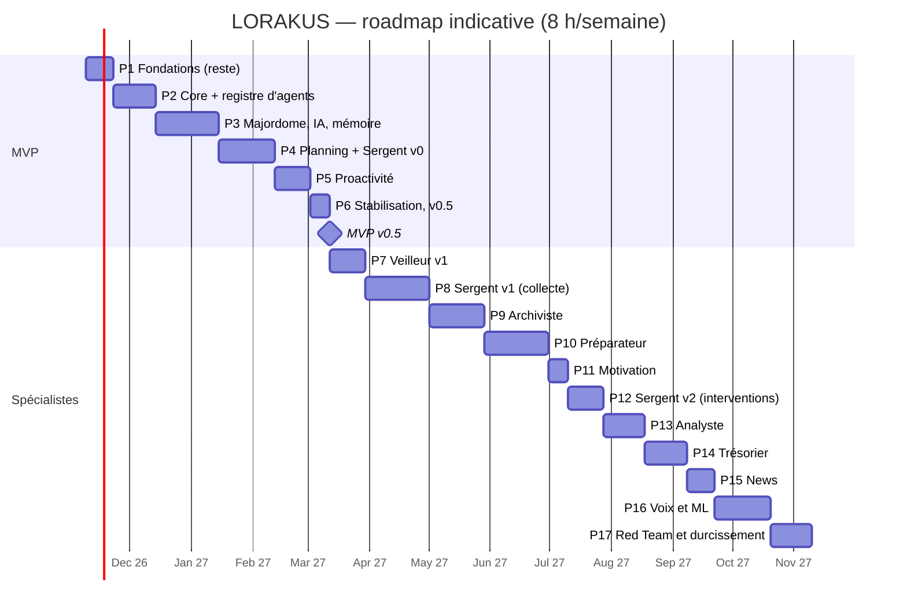

# Roadmap

Version 2.2 (2026-11-09 : environnements de l'ADR 0036, questions de clarification en P4). Version 2.1 (Mission 3 et revue « regard neuf », 2026-11-08) : intègre l'architecture multi-agents validée (ADR 0025 à 0033) avec un MVP allégé. **Gel de la conception jusqu'à la v0.5** : toute nouvelle idée va dans la section « Idées » en fin de fichier et n'est étudiée qu'après le MVP. Durées indicatives à environ 8 h/semaine, à recaler sur la vitesse réelle. Une phase n'est close que si la suite de tests des phases précédentes reste verte et si `PROJECT_STATE.md` est à jour.

## Déjà fait (P0 et début de P1)

Dépôt public protégé, documentation et ADR, backend FastAPI (`/api/health`, `/api/health/ready`), couche base (SQLAlchemy 2 async, psycopg 3, timeouts), Alembic (branche `core`), PostgreSQL 18 + pgvector local avec rôles à moindre privilège, qualité locale (Ruff, pyright strict, pytest, Gitleaks, pre-commit).

## MVP — v0.5 (environ 17,5 semaines)

Scénarios d'acceptation :

1. « Qu'est-ce que je dois faire aujourd'hui ? » → réponse juste (tâches, cours ICS, deadlines), passée par le Sergent, sources citées, en moins de 5 s.
2. « Ajoute le devoir de Machine Learning pour vendredi, environ 3 h » → confirmation → tâche visible dans `/academic` et Today.
3. Briefing du lendemain préparé la nuit et présenté à 7 h 30 ; aucune notification pendant les quiet hours.
4. Un seul rappel J-3 pour un devoir non commencé ; escalade au niveau 2 seulement si le niveau 1 est ignoré.
5. Idée envoyée au bot Telegram → boîte d'idées de `projects`.
6. Préférence exprimée en conversation → fait proposé → confirmé → utilisé par la planification.
7. « Pourquoi m'as-tu dit ça ? » → trace complète (spécialistes appelés, données utilisées, classes transmises au LLM).
8. API coupée → alerte Discord en moins de 5 min ; fournisseur IA coupé → réponse par gabarit, rappels intacts.
9. Restauration automatique du dernier backup réussie.

### P1 — Fondations (terminée le 2026-11-11, v0.1.0)

- **Fait** (PR n°7 à n°18 et PR Runbooks, en production depuis le 2026-11-10) : CI obligatoire, CodeQL, Dependabot, Gitleaks, Trivy, image API non-root, pile Compose durcie, images multi-architectures publiées sur GHCR (PR n°16), déploiement approuvé avec retour automatique (PR n°17), journaux JSON et métriques Prometheus, Grafana, alertes testées vers Discord, sauvegardes chiffrées vers B2 et test de restauration, préparation de l'hôte de production, sauvegarde quotidienne par minuteur systemd, label d'environnement dans les alertes, runbooks liés aux alertes. Essayés en production le 2026-11-10 : retour arrière (10 s), redéploiement (26 s), alerte d'API coupée (2 min 21 s).
- **Fait aussi** (PR n°20) : staging éphémère avant chaque déploiement, vert en conditions réelles ; sentinelle healthchecks.io, disparition détectée en 8 minutes.
- **Reporté hors phase** : clés B2 par machine (`DEPLOYMENT.md` §7.2).
- **Décidé** : pas de VM Azure (ADR 0037) ; Loki reporté en P3 (ADR 0010).
- **Tests** : CI obligatoire sur `main`, restauration, Trivy, image vérifiée sur ARM.
- **Terminée quand** : un déploiement approuvé met la production à jour depuis GHCR (fait) ; le retour arrière a été essayé (fait) ; la sauvegarde quotidienne tourne et son absence alerte (fait) ; la sentinelle alerte quand la production ne répond plus (fait, 8 min) ; le staging a validé un déploiement réel (fait). Les traces corrélées arrivent avec l'observabilité palier 2 (P3).
- **Risque** : temps passé sur l'outillage.

### P2 — Core platform + registre des spécialistes (3 semaines)

- **Composants** : identité, sessions, TOTP, rôles, RLS, API keys ; registre de modules, manifeste, config ; événements (outbox) ; `JobQueue` ; Tool Runtime ; audit ; **`SpecialistProfile`, registre `agents`, modèles `SpecialistRequest` / `SpecialistReport` (avec un champ optionnel « information manquante », utilisé à partir de la P4), table `core_agent_runs`**.
- **Tests** : isolation RLS à deux utilisateurs ; contrat de manifeste et de profil ; un profil invalide empêche le démarrage ; import-linter.
- **Terminée quand** : deux spécialistes factices différents s'enregistrent et répondent via l'API interne.
- **Risque** : contrat de profil trop rigide.
- **Découpage et critères de fin (validés le 2026-11-11)** :
  - **PR 22 — Squelette du Core, versions** : `release-please` ; `lorakus/core/` ; import-linter : le Core (`lorakus`) n'importe jamais `lorakus_modules`, les modules sont indépendants entre eux, couches `api → core → db | observability → settings`.
  - **PR 23 — Identité et RLS** : utilisateur courant positionné par `set_config(…, true)` (portée transaction) au début de chaque transaction, jamais par un `SET` de session ; `FORCE ROW LEVEL SECURITY` sur chaque table ; tests d'isolation exécutés en `lorakus_app`, jamais en superutilisateur ; jeton de session haché en base ; cookie `__Host-` avec `HttpOnly`, `Secure`, `SameSite=Strict` ; expiration par inactivité et durée maximale ; toutes les sessions révoquées au changement de mot de passe ; même message d'erreur et même temps de réponse que le compte existe ou non ; limitation des tentatives par compte et par IP, stockée dans PostgreSQL ; Argon2id au moins aux paramètres OWASP, re-hachage automatique à la connexion si les paramètres sont durcis ; création du propriétaire avec mot de passe lu par `getpass`, jamais en argument.
  - **PR 24 — Correctif** (ajouté) : sauvegarde avant migration avec l'image de la nouvelle version.
  - **PR 25 — TOTP, clés d'API, audit** : secrets TOTP chiffrés en base (clé dans le `.env` du serveur) ; codes de secours hachés et à usage unique ; code TOTP non rejouable dans sa fenêtre ; clés d'API affichées une seule fois, stockées hachées, avec préfixe visible, portée et expiration ; journal d'audit en ajout seul (`UPDATE` et `DELETE` retirés à `lorakus_app`), vérifié par `make db-check`.
  - **PR 26 — Système de modules** : manifeste, découverte, dépendances, activation par utilisateur, configuration, `make new-module`.
  - **PR 27 — Événements et jobs** : outbox, port `JobQueue` (Procrastinate), service `worker` ; marge mémoire de `lorakus-prod` mesurée avec le `worker`, limite mémoire et alerte comme pour l'API.
  - **PR 28 — Outils** : `@tool`, niveaux de risque, confirmation, audit.
  - **PR 29 — Spécialistes** : profils, registre, contrat, `core_agent_runs`, deux spécialistes factices.
  - **PR 30 — Clôture** : v0.2.0 par `make release-pr VERSION=0.2.0`.

### P3 — Majordome, IA et mémoire (4,5 semaines)

- **Composants** : `AIProvider`, `ModelRouter`, budgets ; mémoire ; conversations SSE ; frontend React (design system, login, chat, `/memory`, PWA) ; **orchestrateur (parallélisme, délais, cache, disjoncteur), routage à trois paliers** ; observabilité palier 2 (traces Tempo, journaux Loki). Le filtre de confidentialité n'est pas nécessaire ici : aucun spécialiste sensible avant P10.
- **Dépend de** : D-D (budget IA). Adresse : `app.lorakus.app` (D-G tranchée).
- **Tests** : evals Promptfoo sur `FakeProvider` ; orchestrateur (délais, disjoncteur, cache) ; trace complète d'une question.
- **Terminée quand** : une question multi-spécialistes (factices) obtient une réponse en moins de 5 s avec trace complète ; utilisé 5 jours de suite.
- **Risque** : qualité perçue des réponses.

### P4 — Planning, academic, projects, Sergent v0 (4 semaines)

- **Composants** : `planning` (tâches, agenda, planificateur), `calendars` (ICS), `academic`, `projects`, Today, **module `focus` avec le profil Sergent (échéances, retards, découpage de tâches proposé)**.
- **Questions de clarification** : un spécialiste signale une information manquante dans son `SpecialistReport` ; le Majordome ne pose la question que si la réponse change le résultat, une seule à la fois, en proposant une réponse par défaut tirée de l'historique ; la réponse est mémorisée comme un fait confirmé. Exemple : la durée estimée d'un devoir annoncé sans durée.
- **Dépend de** : D-F.
- **Tests** : règles de retard et de planification ; découpage jamais appliqué sans validation ; synchro ICS sur fichiers réels anonymisés ; aucune question posée quand la réponse ne change rien, jamais deux questions à la suite, la réponse par défaut s'applique sans réponse de l'utilisateur.
- **Terminée quand** : scénarios 1, 2 et 6.
- **Risque** : récurrences ICS et fuseaux horaires.

### P5 — Proactivité (2,5 semaines)

- **Composants** : `signals`, `InterventionPolicy` (niveaux 1 et 2, budget, quiet hours, dédoublonnage, escalade, règles du Sergent v0), **préparations** (briefing du lendemain), Web Push, bot Telegram (jamais de contenu sensible), alertes d'exploitation. Le moteur de situations arrive en P10 ; la file d'approbation avec la première action externe.
- **Tests** : scénarios simulés (budget, quiet hours, dédoublonnage, escalade) ; préparation expirée ; un seul job périodique traite toutes les échéances dues (pas de minuteur par utilisateur).
- **Terminée quand** : scénarios 3, 4, 5, 7 et 8 ; zéro doublon sur 2 semaines.
- **Risque** : agacement → seuils prudents, budget de 3 interventions par jour.

### P6 — Stabilisation et v0.5 (1,5 semaine)

Usage réel, ZAP baseline, exercice d'incident, relecture des runbooks (créés en P1), gel des fonctionnalités. Terminée quand les neuf scénarios passent.

## Après le MVP : un spécialiste à la fois

| Phase | Contenu | Dépend de | Terminée quand | Durée |
| --- | --- | --- | --- | --- |
| P7 | **Veilleur v1** : sondes en lecture seule (`OracleWorker`, staging, Dell), inventaire, OSV et avis des distributions, ports autorisés, rapport hebdomadaire | P5 | Une vulnérabilité réelle signalée avec les machines concernées ; aucune clé SSH détenue par Lorakus | 2,5 sem. |
| P8 | **Sergent v1, collecte** : Lorakus Sensors (UsageStats), extension navigateur, sessions, lignes de base, `/attention`, passkeys | P5 | Sessions à ± 1 min sur 20 cas ; synchronisation sans trou sur 7 jours | 4,5 sem. |
| P9 | **Archiviste** : inbox universelle, ingestion, graphe, FSRS, questions de révision citées | P3 | Lien partagé résumé en < 60 s ; séance de révision générée depuis vos cours | 4 sem. |
| P10 | **Préparateur** : Health Connect, Strava (`no_ai`), séances, sommeil ; **filtre de confidentialité** (ADR 0027) et **moteur de situations** (ADR 0030), situation `overloaded_day` | P8 | Course comptée une fois ; aucune valeur de santé dans une requête LLM (test d'interception) ; mauvaise nuit + journée chargée → programme allégé proposé | 4,5 sem. |
| P11 | Motivation (module de domaine) | P9 | ≤ 3 présentations par semaine | 1,5 sem. |
| P12 | **Sergent v2, interventions** : situations de Mission 1, pactes de niveau 3 | P8 + 8 semaines de données, P10, P11, D-J | Chaque activation journalisée ; sortie de secours testée | 2,5 sem. |
| P13 | **Analyste** : PubAPI, Stockfish de nuit, gaffes, gestion du temps, exercices tirés de vos parties | P8 | Faiblesse au temps démontrée sur vos vraies parties | 3 sem. |
| P14 | **Trésorier** : imports, catégorisation, récurrences, anomalies, projection d'épargne | P2, D-I | Aucune valeur financière dans une requête LLM (test) ; aucun appel réseau à l'import | 3 sem. |
| P15 | News (module de domaine), alimente Veilleur et Archiviste | P9 | « Quoi de neuf ? » utile 4 jours sur 5 | 2 sem. |
| P16 | Voix, ML (bandit, classifieurs) | ≥ 6 mois de données | Chaque modèle bat les règles en validation temporelle | Ouvert |
| P17 | Red Team, durcissement, rôles PostgreSQL par spécialiste sensible | Tout | Rapport mensuel automatique ; aucune `high` ouverte > 30 jours | 3 sem. |

## Risques transverses

| Risque | Mitigation |
| --- | --- |
| Sur-ingénierie de l'infrastructure d'agents | Un seul spécialiste réel au MVP ; aucun mécanisme sans consommateur |
| Latence cumulée | Appels parallèles, délais, cache, préparations de nuit |
| Fuite de valeurs sensibles via la synthèse | Filtre structurel + test d'interception en CI |
| Trop de notifications à mesure que les spécialistes s'ajoutent | Moteur de situations et budget global unique |

## Idées (étudiées après la v0.5)

- **Offre commerciale modulaire** : formules regroupant des modules au choix (par exemple Strava sans les échecs), définies à partir de sondages auprès d'utilisateurs potentiels. Déjà compatible avec l'activation des modules par utilisateur (phase 2) ; ajouter des « droits » par formule le moment venu.
- **Authentification et facturation au moment de vendre** : réévaluer Clerk pour l'authentification ; Stripe pour la facturation (25 $ de crédit étudiant) ; Testmail pour tester l'envoi d'e-mails si Lorakus en envoie un jour.
- **Heures de prière** : calcul local déterministe (ou Mawaqit si un accès autorisé existe), créneaux ajoutés à l'agenda, situation « heure de prière et réseaux sociaux » traitée par un pacte volontaire (notification plein écran, Ne pas déranger, blocage par l'extension sur PC). Fermer une application Android de force exigerait le service d'accessibilité, écarté par l'ADR 0016. Donnée religieuse, donc catégorie sensible du RGPD : module désactivé par défaut, classé `sensitive`, jamais transmis à un LLM, consentement explicite en cas de vente.
- **Aide à l'apprentissage** (proposé le 2026-11-10) : révision orale d'un cours en répétition espacée (« Anas, c'est quoi un réseau de neurones ? »), lancée environ une semaine avant un quiz ou un examen. S'appuie sur l'Archiviste (cartes de révision, P9), le module académique (échéances, P4) et la voix (P16).
- **Mémorisation de sourates** (usage personnel, jamais vendu) : texte découpé en parties, proposées sur les créneaux libres de l'agenda. Même moteur de répétition espacée ; même régime que les heures de prière (module désactivé par défaut, `sensitive`, jamais transmis à un LLM).
- **Emploi du temps** : déjà lu par lien ICS en lecture seule (ADR 0020, Google Agenda en fournit un) ; un accès complet à Google Agenda reste à étudier.
- **Personnalité « professeur »** pour les révisions : ton et façon d'interroger propres au mode révision.
- **Montre connectée** : déjà prévue avec le Préparateur (P10), via Mi Fitness puis Health Connect.
- **Alertes d'exploitation** : lien vers le tableau de bord Grafana dans chaque alerte (P6, quand Grafana aura une adresse) ; le lien vers le runbook est fait (P1).
