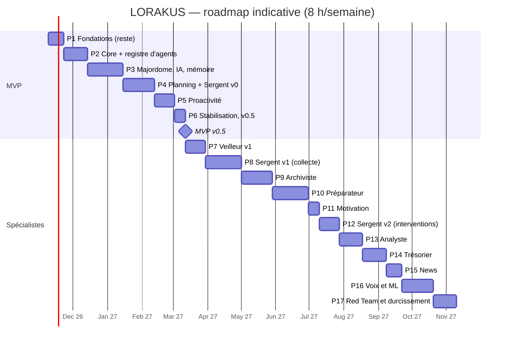

# Roadmap

Version 2.1 (Mission 3 et revue « regard neuf », 2026-11-08) : intègre l'architecture multi-agents validée (ADR 0025 à 0033) avec un MVP allégé. **Gel de la conception jusqu'à la v0.5** : toute nouvelle idée va dans la section « Idées » en fin de fichier et n'est étudiée qu'après le MVP. Durées indicatives à environ 8 h/semaine, à recaler sur la vitesse réelle. Une phase n'est close que si la suite de tests des phases précédentes reste verte et si `PROJECT_STATE.md` est à jour.

## Déjà fait (P0 et début de P1)

Dépôt public protégé, documentation et ADR, backend FastAPI (`/api/health`, `/api/health/ready`), couche base (SQLAlchemy 2 async, psycopg 3, timeouts), Alembic (branche `core`), PostgreSQL 18 + pgvector local avec rôles à moindre privilège, qualité locale (Ruff, pyright strict, pytest, Gitleaks, pre-commit).

## MVP — v0.5 (environ 17,5 semaines)

Scénarios d'acceptation :

1. « Qu'est-ce que je dois faire aujourd'hui ? » → réponse juste (tâches, cours ICS, deadlines), passée par le Sergent, sources citées, en moins de 5 s.
2. « Ajoute le devoir de Machine Learning pour vendredi, environ 3 h » → confirmation → tâche visible dans `/academic` et Today.
3. Briefing du lendemain préparé la nuit et présenté à 7 h 30 ; aucune notification pendant les quiet hours.
4. Un seul rappel J-3 pour un devoir non commencé ; escalade au niveau 2 seulement si le niveau 1 est ignoré.
5. Idée envoyée au bot Telegram → boîte d'idées de `projects`.
6. Préférence exprimée en conversation → fait proposé → confirmé → utilisé par la planification.
7. « Pourquoi m'as-tu dit ça ? » → trace complète (spécialistes appelés, données utilisées, classes transmises au LLM).
8. API coupée → alerte Telegram en moins de 5 min ; fournisseur IA coupé → réponse par gabarit, rappels intacts.
9. Restauration automatique du dernier backup réussie.

### P1 — Fondations (reste : 2 semaines)

- **Composants** : CI GitHub Actions (`make check` avec PostgreSQL, titre de PR au format Conventional Commits), `dependabot.yml` (uv, Docker, Actions), CodeQL, image Docker de l'API (multi-arch, non-root), observabilité palier 1 (journaux structurés JSON, métriques Prometheus, Grafana, alertes ; instrumentation OpenTelemetry), sauvegardes chiffrées + test de restauration, staging sur la 2e instance A1, premier déploiement sur `OracleWorker`.
- **Tests** : CI obligatoire sur `main`, restauration, Trivy.
- **Terminée quand** : un push déploie le staging ; une requête est visible dans Grafana (log, métrique, trace corrélés).
- **Risque** : temps passé sur l'outillage.

### P2 — Core platform + registre des spécialistes (3 semaines)

- **Composants** : identité, sessions, TOTP, rôles, RLS, API keys ; registre de modules, manifeste, config ; événements (outbox) ; `JobQueue` ; Tool Runtime ; audit ; **`SpecialistProfile`, registre `agents`, modèles `SpecialistRequest` / `SpecialistReport`, table `core_agent_runs`**.
- **Tests** : isolation RLS à deux utilisateurs ; contrat de manifeste et de profil ; un profil invalide empêche le démarrage ; import-linter.
- **Terminée quand** : deux spécialistes factices différents s'enregistrent et répondent via l'API interne.
- **Risque** : contrat de profil trop rigide.

### P3 — Majordome, IA et mémoire (4,5 semaines)

- **Composants** : `AIProvider`, `ModelRouter`, budgets ; mémoire ; conversations SSE ; frontend React (design system, login, chat, `/memory`, PWA) ; **orchestrateur (parallélisme, délais, cache, disjoncteur), routage à trois paliers** ; observabilité palier 2 (traces Tempo). Le filtre de confidentialité n'est pas nécessaire ici : aucun spécialiste sensible avant P10.
- **Dépend de** : D-D (budget IA), D-G (adresse HTTPS).
- **Tests** : evals Promptfoo sur `FakeProvider` ; orchestrateur (délais, disjoncteur, cache) ; trace complète d'une question.
- **Terminée quand** : une question multi-spécialistes (factices) obtient une réponse en moins de 5 s avec trace complète ; utilisé 5 jours de suite.
- **Risque** : qualité perçue des réponses.

### P4 — Planning, academic, projects, Sergent v0 (4 semaines)

- **Composants** : `planning` (tâches, agenda, planificateur), `calendars` (ICS), `academic`, `projects`, Today, **module `focus` avec le profil Sergent (échéances, retards, découpage de tâches proposé)**.
- **Dépend de** : D-F.
- **Tests** : règles de retard et de planification ; découpage jamais appliqué sans validation ; synchro ICS sur fichiers réels anonymisés.
- **Terminée quand** : scénarios 1, 2 et 6.
- **Risque** : récurrences ICS et fuseaux horaires.

### P5 — Proactivité (2,5 semaines)

- **Composants** : `signals`, `InterventionPolicy` (niveaux 1 et 2, budget, quiet hours, dédoublonnage, escalade, règles du Sergent v0), **préparations** (briefing du lendemain), Web Push, bot Telegram (jamais de contenu sensible), alertes d'exploitation. Le moteur de situations arrive en P10 ; la file d'approbation avec la première action externe.
- **Tests** : scénarios simulés (budget, quiet hours, dédoublonnage, escalade) ; préparation expirée ; un seul job périodique traite toutes les échéances dues (pas de minuteur par utilisateur).
- **Terminée quand** : scénarios 3, 4, 5, 7 et 8 ; zéro doublon sur 2 semaines.
- **Risque** : agacement → seuils prudents, budget de 3 interventions par jour.

### P6 — Stabilisation et v0.5 (1,5 semaine)

Usage réel, ZAP baseline, exercice d'incident, runbooks, gel des fonctionnalités. Terminée quand les neuf scénarios passent.

## Après le MVP : un spécialiste à la fois

| Phase | Contenu | Dépend de | Terminée quand | Durée |
| --- | --- | --- | --- | --- |
| P7 | **Veilleur v1** : sondes en lecture seule (`OracleWorker`, staging, Dell), inventaire, OSV et avis des distributions, ports autorisés, rapport hebdomadaire | P5 | Une vulnérabilité réelle signalée avec les machines concernées ; aucune clé SSH détenue par Lorakus | 2,5 sem. |
| P8 | **Sergent v1, collecte** : Lorakus Sensors (UsageStats), extension navigateur, sessions, lignes de base, `/attention`, passkeys | P5 | Sessions à ± 1 min sur 20 cas ; synchronisation sans trou sur 7 jours | 4,5 sem. |
| P9 | **Archiviste** : inbox universelle, ingestion, graphe, FSRS, questions de révision citées | P3 | Lien partagé résumé en < 60 s ; séance de révision générée depuis vos cours | 4 sem. |
| P10 | **Préparateur** : Health Connect, Strava (`no_ai`), séances, sommeil ; **filtre de confidentialité** (ADR 0027) et **moteur de situations** (ADR 0030), situation `overloaded_day` | P8 | Course comptée une fois ; aucune valeur de santé dans une requête LLM (test d'interception) ; mauvaise nuit + journée chargée → programme allégé proposé | 4,5 sem. |
| P11 | Motivation (module de domaine) | P9 | ≤ 3 présentations par semaine | 1,5 sem. |
| P12 | **Sergent v2, interventions** : situations de Mission 1, pactes de niveau 3 | P8 + 8 semaines de données, P10, P11, D-J | Chaque activation journalisée ; sortie de secours testée | 2,5 sem. |
| P13 | **Analyste** : PubAPI, Stockfish de nuit, gaffes, gestion du temps, exercices tirés de vos parties | P8 | Faiblesse au temps démontrée sur vos vraies parties | 3 sem. |
| P14 | **Trésorier** : imports, catégorisation, récurrences, anomalies, projection d'épargne | P2, D-I | Aucune valeur financière dans une requête LLM (test) ; aucun appel réseau à l'import | 3 sem. |
| P15 | News (module de domaine), alimente Veilleur et Archiviste | P9 | « Quoi de neuf ? » utile 4 jours sur 5 | 2 sem. |
| P16 | Voix, ML (bandit, classifieurs) | ≥ 6 mois de données | Chaque modèle bat les règles en validation temporelle | Ouvert |
| P17 | Red Team, durcissement, rôles PostgreSQL par spécialiste sensible | Tout | Rapport mensuel automatique ; aucune `high` ouverte > 30 jours | 3 sem. |

## Risques transverses

| Risque | Mitigation |
| --- | --- |
| Sur-ingénierie de l'infrastructure d'agents | Un seul spécialiste réel au MVP ; aucun mécanisme sans consommateur |
| Latence cumulée | Appels parallèles, délais, cache, préparations de nuit |
| Fuite de valeurs sensibles via la synthèse | Filtre structurel + test d'interception en CI |
| Trop de notifications à mesure que les spécialistes s'ajoutent | Moteur de situations et budget global unique |

## Idées (étudiées après la v0.5)

- **Offre commerciale modulaire** : formules regroupant des modules au choix (par exemple Strava sans les échecs), définies à partir de sondages auprès d'utilisateurs potentiels. Déjà compatible avec l'activation des modules par utilisateur (phase 2) ; ajouter des « droits » par formule le moment venu.
